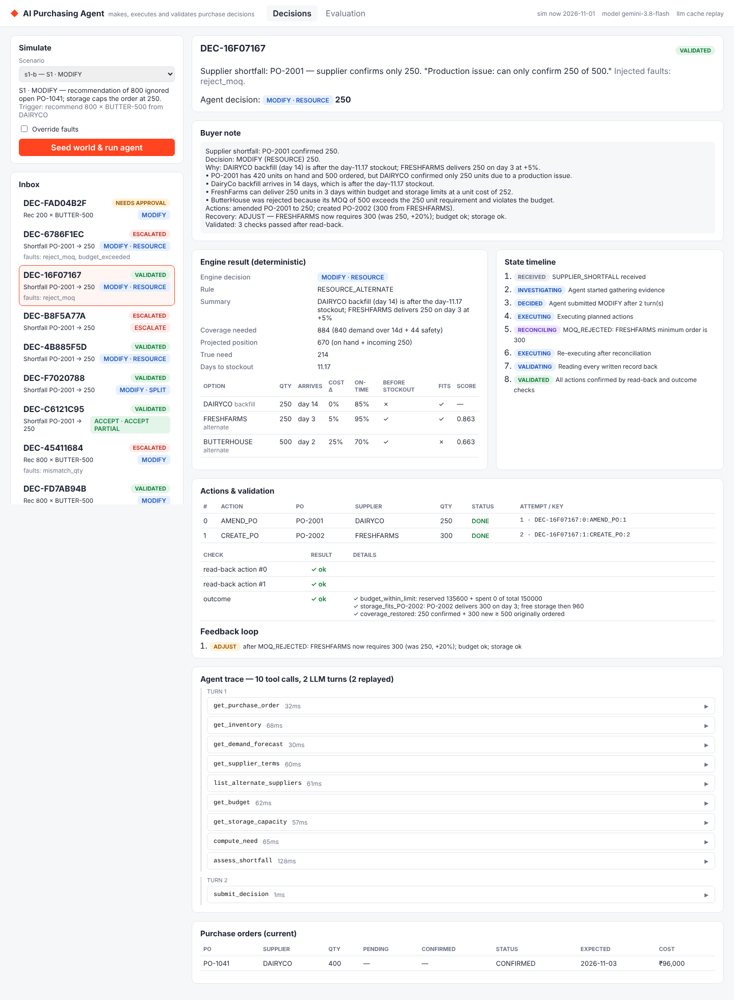

# AI Purchasing Agent

An agent for a quick-commerce buyer that **makes, executes and validates purchasing decisions**. It reviews replenishment recommendations (Scenario 1) and responds to supplier shortfalls (Scenario 2). It gathers evidence through tools, lets a deterministic engine compute every quantity, routes risky actions to a human, places and amends purchase orders, reads every write back, and recovers when the result is not what it expected. It retries, adjusts, compensates or escalates as needed.

> "The goal is not to build a chatbot that answers purchasing questions. The goal is to demonstrate a system capable of making, executing, and validating purchasing decisions."



## Demo

▶ **Demo video (3 min):** DEMO_VIDEO_LINK — a live run of Scenario 1 (modify, then human approval) and Scenario 2 (re-source, adjust after a rejected order, compensate after a second failure), then the evaluation tab.

To run it yourself without a Gemini key, set `LLM_CACHE=replay` in `.env`: every scenario then replays recorded model responses.

## Run it

Requirements: Node 20+, and a MongoDB (Atlas free tier, or `docker compose up -d` for a local one).

```bash
cp .env.example .env        # then fill in GEMINI_API_KEY, MODEL, MONGO_URI
npm install
npm run dev                 # API on :4000, UI on http://localhost:5173
```

Useful commands:

| Command | What it does |
|---|---|
| `npm test` | 42 unit tests: engine and contracts. Pure, no network. |
| `npm run eval` | 14 end-to-end scenarios replayed from recorded LLM responses. Deterministic, no API key needed. |
| `npm run eval:record` | Records LLM responses the fixtures do not have yet, using the real model. |
| `npm run eval:live` | Calls the model for every turn and refreshes the fixtures. |
| `npm run seed -- s1-b` | Resets the world to a scenario (`npm run seed -- --list` lists them). |
| `npm run llm:ping` / `npm run db:ping` | Checks the Gemini key, model and function calling, or the database connection. |
| `npm run show -- <decisionId>` | Prints a decision trace in the terminal. |

**No API key?** Set `LLM_CACHE=replay` in `.env`. The app then serves the recorded model responses for every scenario, so the whole demo runs offline.

## Demo script (UI)

Use **Simulate → pick a scenario → Seed world & run agent**. Each run re-seeds the database and fires that scenario's trigger and faults.

1. **`s1-b`, MODIFY.** The system recommends 800. The agent finds PO-1041 (400) already inbound, computes a true need of 334, and sees storage caps the order at 250. It orders 250, reads PO-1042 back and validates it.
2. **`s1-e`, human in the loop.** The recommendation of 200 is too low, and the agent wants 350 (+75%), so policy stops at **NEEDS APPROVAL**. Click **Approve & execute**.
3. **`s2-c`, re-source.** DairyCo confirms 250 of 500, and its backfill (day 14) lands after the projected stockout (day 11.17). FreshFarms delivers on day 3 at +5%, so the agent amends PO-2001 to 250 and creates PO-2002.
4. **`s2-e`, ADJUST.** FreshFarms rejects 250 because its MOQ is now 300. The agent re-checks budget and storage, adjusts to 300 on a new idempotency key, re-executes and validates.
5. **`s2-f`, COMPENSATE.** The adjusted order then fails on budget. The agent reverts the PO-2001 amendment and escalates with priced options and a clean state.
6. **`s1-f` / `s1-g` / `s1-h`, retry, read-back and mismatch.** A timeout after the write is retried with the same key (no duplicate PO). A PO that is not readable yet is re-read. A silently changed quantity that breaks storage is cancelled and escalated.
7. **Evaluation tab → Run all cases (replay).** 14/14, each with an **Open trace** link.

## How it works (one paragraph)

The **LLM plans; code decides.** Gemini is given read tools, two engine tools (`check_constraints`, `assess_shortfall`) and `submit_decision`. In its first turn it gathers all the evidence in parallel. In the second it submits a decision with reasoning written from the engine's labelled **evidence facts**. A **decision guard** rejects any submission that disagrees with the deterministic engine, or whose reasoning cites a number not in those facts, so neither the quantities nor the explanation can drift from the evidence. A **policy table** decides whether a human must approve. **Execution** runs the engine's plan (amend before create), with **idempotency keys** on every write. **Validation** reads every record back and checks the whole outcome: budget, storage on each delivery day, and coverage restored. On any mismatch, the **reconciler** picks exactly one of RETRY / ADJUST / COMPENSATE / ESCALATE. Every step is appended to one MongoDB document per decision, and that document is the audit log, the UI and the evaluation evidence.

## How the agent's decisions are validated

Validation happens at four points, and each one is recorded in the decision trace:

1. **Before acting: the decision guard.** The model's `submit_decision` is checked against the deterministic engine (decision, quantity, strategy and every action), and every number in its reasoning is checked against the engine's evidence facts. A mismatch is rejected and the model must resubmit.
2. **Before money moves: the policy gate.** Rules in `server/src/engine/policy.ts` send large orders, large increases over the recommendation, expensive supplier switches and risky re-executions to a human (NEEDS APPROVAL).
3. **After every write: read-back.** Each created or amended purchase order is read back and compared field by field with what was expected: quantity, supplier, status, cost and any pending amendment.
4. **After all writes: outcome checks.** The budget stays within its total, storage fits on every delivery day, and in Scenario 2 the originally ordered quantity is covered again.

When a check fails, the reconciler chooses one move: RETRY (same idempotency key, so no duplicate orders), ADJUST (for example a new MOQ, re-checked against budget and storage), COMPENSATE (undo the completed steps) or ESCALATE (a clean state plus priced options for the buyer). Details are in [docs/approach.md](docs/approach.md#the-feedback-loop), and the 14 cases in [docs/evaluation.md](docs/evaluation.md) prove each path.

## Documents

- [docs/architecture.md](docs/architecture.md): components, state machine, data model, tools
- [docs/approach.md](docs/approach.md): the problem, design principles, the feedback loop, policy, trade-offs, roadmap
- [docs/evaluation.md](docs/evaluation.md): the 14 cases, what each proves, and the results
- [docs/implementation-plan.md](docs/implementation-plan.md): the plan this was built from

## Repository layout

```
shared/   Zod contracts shared by server and client (decision schema, triggers, domain types)
server/   Express API, mock external systems, deterministic engine, tools, agent loop, eval
  src/engine/   pure functions: calculator, constraints, trust, policy, recommendation,
                shortfall, supplierScore, stateMachine, validator, reconciler, guard
  src/tools/    HTTP client to the mock systems, LLM tool registry, write tools
  src/agent/    LLM adapter (Gemini), record/replay cache, loop, execute, reconcile, explain
  src/mock/     the "external systems" with fault injection (x-fault header)
  src/seed/     14 scenario worlds
client/   React + Vite + TanStack Query: inbox, decision trace, approvals, simulate, evaluation
eval/     scenarios/*.json (cases), fixtures/*.json (recorded LLM responses)
docs/     architecture, approach, evaluation, plan, screenshots
```

## Notes

- **Stack:** TypeScript end to end (Node, Express, React), MongoDB with Mongoose, Google Gemini via `@google/genai` (free tier), Zod and Vitest. No agent framework: the loop is about 100 lines in `server/src/agent/loop.ts`.
- **Model:** the fixtures were recorded with `gemini-3.5-flash-lite`. The free tier of larger models can be as low as 20 requests per day, which is too few for evaluation. Replay always uses the model recorded in `eval/fixtures/_manifest.json`.
- **Simulated time:** the world runs on a fixed clock (`SIM_NOW`), so data freshness, lead times and recorded fixtures are reproducible.
- **AI assistance:** this project was built with AI coding assistance, which the assignment allows. Every design decision is documented in `docs/approach.md`.
