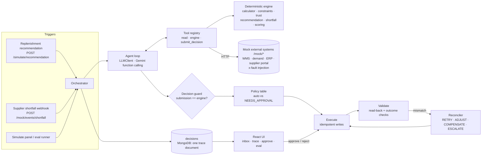
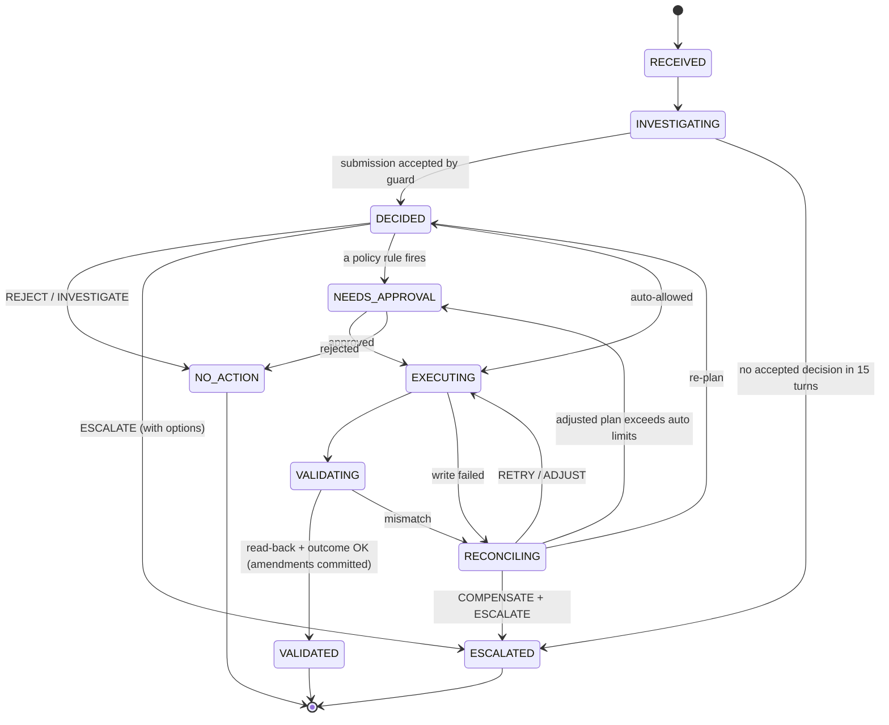

# Architecture

## Components

| Component | Where | Responsibility |
|---|---|---|
| Mock external systems | `server/src/mock/` | Inventory and storage (WMS), forecast, purchase orders and budget (ERP), supplier terms, backfill and webhook. Reached only over HTTP. Faults are injected with `x-fault` / `x-fault-key` headers, and each fires once per decision. |
| Engine | `server/src/engine/` | Pure functions, no I/O: need calculation, constraint resolution, data-trust checks, the Scenario 1 and Scenario 2 decision rules, supplier scoring, the state machine, read-back validation, the reconciler policy, the approval policy and the decision guard. 35 unit tests. |
| Tools | `server/src/tools/` | Typed tool definitions (Zod), converted to JSON Schema for the model. Read tools fetch evidence; engine tools run the engine on fresh data; write tools are not exposed to the model and refuse to run outside the right state. |
| LLM adapter | `server/src/agent/llm.ts` | The `LLMClient` interface and a Gemini implementation: forced function calling, opaque model content passed back unchanged (thought signatures), backoff on 429/5xx, fail-fast on daily-quota errors, and a minimum spacing between calls. The only file that imports `@google/genai`. |
| Record/replay cache | `server/src/agent/llmCache.ts` | Hashes the full request (system, messages, tools, model). Modes: replay, record and live. Fixtures live in `eval/fixtures`. |
| Agent loop | `server/src/agent/loop.ts` | Runs up to 15 turns, executes tool calls, writes every call to the trace, and ends only when `submit_decision` passes the guard. |
| Execute / reconcile | `server/src/agent/execute.ts`, `reconcile.ts` | Runs the plan, reads everything back, checks the outcome, commits soft amendments, and picks a recovery move on mismatch. |
| Orchestrator | `server/src/agent/orchestrator.ts` | Investigate, then the policy gate, then execute. Also approve/reject, background runs, a safety net that leaves an explained terminal state on any unexpected error, and a PO snapshot at completion. |
| UI | `client/` | Inbox, decision detail (buyer note, engine numbers, state timeline, actions and validation, feedback loop, agent trace, PO snapshot), approvals, simulate panel, evaluation tab. |

## Decision state machine

`engine/stateMachine.ts` holds the allowed transitions as a table. An illegal move throws. Every transition is appended to the decision as `{ from, to, at, reason, expected?, observed? }`.

## One decision, end to end (Scenario 2, case E)

1. The supplier webhook records `PO-2001 confirmed 250 of 500` and starts a decision. The trigger carries the SKU, node, supplier and ordered quantity.
2. **Turn 1.** The model calls 9 tools in parallel: the PO, inventory, forecast, supplier terms, alternates, budget, storage, `compute_need` (overriding PO-2001 to 250) and `assess_shortfall`. The engine finds a stockout on day 11.17, a DairyCo backfill on day 14 (too late), FreshFarms on day 3 at +5% scoring 0.863, and ButterHouse over budget.
3. **Turn 2.** The model submits `MODIFY / RESOURCE`: amend PO-2001 to 250 and create 250 from FreshFarms, with reasoning. The guard compares it with the engine and accepts it.
4. **Policy.** The +5% premium and ₹63,000 order value are within auto limits, so the decision goes straight to EXECUTING.
5. **Execute.** A soft amend of PO-2001 sets `pendingQty=250` and releases ₹60,000 of reserved budget. The create from FreshFarms returns **422 MOQ_NOT_MET (moq 300)**.
6. **Reconcile, ADJUST.** The quantity becomes 300 (whole packs, at least the MOQ). Fresh data shows ₹75,600 fits the ₹90,000 remaining and storage on day 3 has room for 960. Growth is +20%, within the auto-adjust limit. The attempt becomes 2, which gives a new idempotency key.
7. **Execute.** PO-2002 is created for 300.
8. **Validate.** Both records are read back. The outcome checks pass: budget within total, storage fits on day 3, and coverage restored (250 + 300 ≥ 500). The PO-2001 amendment is then committed, and the decision is **VALIDATED**.

## Data model (MongoDB)

| Collection | Key fields |
|---|---|
| `skus` | sku, name, category (selects the budget), zone (selects the storage), packSize |
| `inventory` | sku, node, onHand, reserved, updatedAt |
| `forecasts` | sku, node, dailyMean, dailyStdDev, horizonDays, generatedAt |
| `purchaseOrders` | poId, sku, node, supplierId, qty, **pendingQty** (soft amendment), confirmedQty, unitCost, totalCost, status, expectedDate, **idempotencyKey (unique, sparse)**, decisionId, history[] |
| `suppliers` | supplierId, name, reliability { onTimeRate, fillRate, avgLeadDelta } |
| `supplierTerms` | supplierId, sku, leadTimeDays, moq, packSize, unitCost, backfillLeadDays |
| `budgets` | node, category, period, total, reserved, spent |
| `storage` | node, zone, capacityUnits, usedUnits, reservedInboundUnits (space booked by other deliveries) |
| `poEvents` | poId, type (SHORTFALL), payload, receivedAt, decisionId |
| `decisions` | one document per decision: trigger, faults, state, toolCalls[], computed{}, engine, decision, rejectedSubmissions[], actions[], validations[], reconciliations[], transitions[], approval, escalation, explanation, llm usage, finalPurchaseOrders |

## Tools offered to the model

| Tool | Purpose |
|---|---|
| `get_inventory`, `get_demand_forecast`, `get_open_purchase_orders`, `get_purchase_order`, `get_supplier_terms`, `list_alternate_suppliers`, `get_budget`, `get_storage_capacity` | Evidence |
| `compute_need` | Need over lead time plus review period, with safety stock; optional override of an open PO's quantity |
| `check_constraints` | Scenario 1 engine: data trust, MOQ/pack, budget and storage caps, then the engine decision with labelled evidence facts |
| `assess_shortfall` | Scenario 2 engine: stockout risk, backfill timing, ranked alternates with budget/storage/premium checks, then the engine decision with labelled evidence facts |
| `submit_decision` | Final answer (Zod schema); the guard checks it against the engine and checks every number in the reasoning against the facts |

Write operations (create, amend, commit, revert, cancel) are **not** model tools. Execution runs them from the engine's plan, and each refuses to run outside its state: EXECUTING, VALIDATING or RECONCILING.
