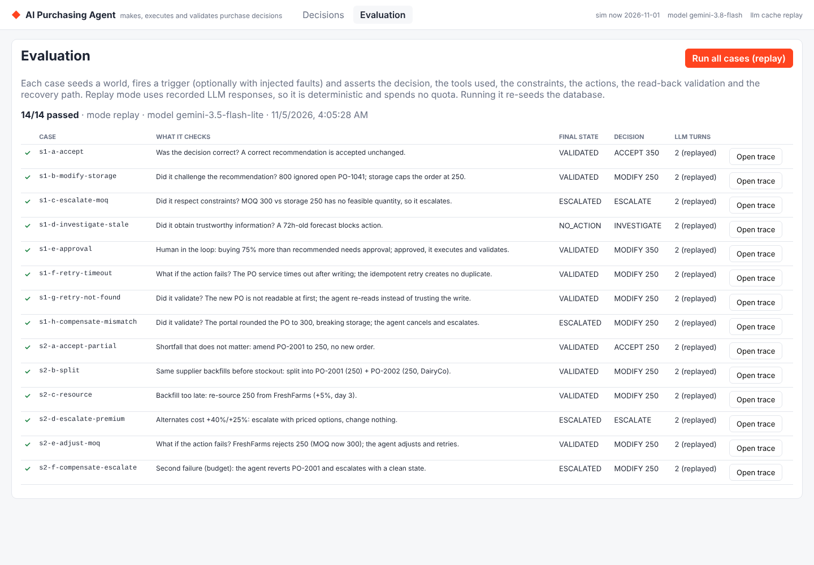

# Evaluation

## Approach

Each case in `eval/scenarios/*.json` is a **seeded world, a trigger, optional injected faults and expectations**. The runner (`server/src/eval/runner.ts`) does the following for each case:

1. Re-seeds MongoDB with the scenario's world and resets the simulated clock and the fault registry.
2. Fires the trigger the way production would: a recommendation through the orchestrator, a shortfall through the supplier webhook.
3. Waits for a terminal state. A case marked `approve` is approved when it reaches NEEDS_APPROVAL, and the runner keeps waiting.
4. Asserts the expectations against the decision document and the resulting purchase orders.

The LLM is wrapped in a record/replay cache keyed on the full request, so the default run is **deterministic, offline and free**:

```bash
npm run eval                 # replay recorded responses (fails loudly on a miss)
npm run eval:record          # record responses the fixtures do not have yet (real model)
npm run eval:live            # call the model for every turn and refresh the fixtures
npm run eval -- --case s2-e  # one case
```

## What the assertions check

| Assignment question | Assertion |
|---|---|
| Was the decision correct? | `decision`, `strategy`, `quantity`, `finalState` |
| Did it obtain the necessary information? | `toolsCalledIncludes`: every required tool succeeded **before** the accepted `submit_decision` |
| Did it respect constraints? | `constraintsHit` (STORAGE, MOQ, …) and resulting PO quantities |
| Did it take the appropriate action? | `actions` types, and the resulting POs (`pos`: exists or not, supplier, qty, pending qty, status) |
| Did it validate the result? | `validated`: VALIDATED and the final outcome check passed |
| What happens when the action does not work? | `reconciliationMoves` (exact sequence), `posCreatedByDecision` (no duplicates), and the final PO state after compensation |
| When is a human needed? | `approvalRequired` |

## Cases

| Case | Scenario | Fault | Expected |
|---|---|---|---|
| s1-a-accept | Recommendation 350 matches the need | — | ACCEPT 350, PO-1042 created, VALIDATED |
| s1-b-modify-storage | Recommendation 800 ignores PO-1041; storage binds | — | MODIFY 250, STORAGE hit, VALIDATED |
| s1-c-escalate-moq | MOQ 300 above storage cap 250 | — | ESCALATE, no PO |
| s1-d-investigate-stale | Forecast 72h old | — | INVESTIGATE, NO_ACTION, no PO |
| s1-e-approval | Recommendation 200, agent wants 350 (+75%) | — | NEEDS_APPROVAL → approved → VALIDATED |
| s1-f-retry-timeout | PO service times out after writing | timeout | RETRY, exactly 1 PO for the decision |
| s1-g-retry-not-found | New PO not readable at first | not_found | RETRY (re-read), VALIDATED |
| s1-h-compensate-mismatch | Portal rounds the PO up to 300, breaking storage | mismatch_qty | ADJUST rejected, then COMPENSATE (PO cancelled), ESCALATED |
| s1-i-reject | Recommendation 800, but 600 on hand + PO-1041 (400) already cover the 884 needed | — | REJECT, NO_ACTION, no PO |
| s2-a-accept-partial | 700 on hand; the shortfall does not matter | — | ACCEPT (partial), PO-2001 → 250 |
| s2-b-split | DairyCo backfills on day 9 < stockout day 11.17 | — | MODIFY (split), PO-2002 DairyCo 250 |
| s2-c-resource | Backfill day 14 too late; FreshFarms day 3, +5% | — | MODIFY (re-source), PO-2002 FreshFarms 250 |
| s2-d-escalate-premium | Alternates +40% / +25% | — | ESCALATE with priced options, nothing changed |
| s2-e-adjust-moq | FreshFarms MOQ now 300 | reject_moq | ADJUST to 300, VALIDATED |
| s2-f-compensate-escalate | MOQ rejection, then budget failure | reject_moq, budget_exceeded | ADJUST, then COMPENSATE (PO-2001 back to 500), ESCALATED |

The same LLM conversation is shared by cases with the same world and trigger (s1-b, s1-f, s1-g, s1-h; s2-c, s2-e, s2-f). Faults only affect execution, which happens after the model has decided. Recovery is therefore tested on exactly the decision the model made.

## Results

Responses were recorded with `gemini-3.5-flash-lite` (the model is listed in `eval/fixtures/_manifest.json`). Replay run (`npm run eval`):

```
Evaluation (mode=replay)
PASS  s1-a-accept                  VALIDATED      ACCEPT      350   turns=2
PASS  s1-b-modify-storage          VALIDATED      MODIFY      250   turns=2
PASS  s1-c-escalate-moq            ESCALATED      ESCALATE    -     turns=2
PASS  s1-d-investigate-stale       NO_ACTION      INVESTIGATE -     turns=2
PASS  s1-e-approval                VALIDATED      MODIFY      350   turns=2
PASS  s1-f-retry-timeout           VALIDATED      MODIFY      250   turns=2
PASS  s1-g-retry-not-found         VALIDATED      MODIFY      250   turns=2
PASS  s1-h-compensate-mismatch     ESCALATED      MODIFY      250   turns=2
PASS  s1-i-reject                  NO_ACTION      REJECT      0     turns=2
PASS  s2-a-accept-partial          VALIDATED      ACCEPT      250   turns=2
PASS  s2-b-split                   VALIDATED      MODIFY      250   turns=2
PASS  s2-c-resource                VALIDATED      MODIFY      250   turns=2
PASS  s2-d-escalate-premium        ESCALATED      ESCALATE    -     turns=2
PASS  s2-e-adjust-moq              VALIDATED      MODIFY      250   turns=2
PASS  s2-f-compensate-escalate     ESCALATED      MODIFY      250   turns=2
15/15 passed
```

Replay passes 15/15 on consecutive runs, with zero cache misses. The quantity column is the quantity the agent *decided*; the executed quantity can differ after recovery (for example, 300 in s2-e) and is asserted on the purchase orders.

Unit tests (`npm test`): 42 passing. Of these, 39 are engine tests covering every scenario's numbers, policy rules, state machine, validator, reconciler, guard, evidence facts and reasoning grounding, and 3 are contract tests.

## What the evaluation surfaced while building

- **Non-deterministic tool output** broke replay for two cases: suppliers were returned in database order. Every list result is now sorted, and fixtures store the full request, so any future mismatch can be diffed (`eval/results/misses/`).
- **Extra turns in Scenario 2.** The model guessed the SKU before reading the PO. The supplier webhook now puts SKU, node, supplier and ordered quantity on the trigger, and every case now takes exactly 2 turns.
- **A fault that contradicted itself.** The first `budget_exceeded` fault rejected the order but reported the real budget, which had room ("₹75,600 exceeds ₹90,000", then "approve ₹-14,400"). The fault now simulates a real race: another buyer reserves part of the budget between the agent's check and its write, so the order genuinely no longer fits (₹75,600 against ₹63,000 remaining, "approve ₹12,600 extra").
- **Free-tier quota.** `gemini-3.8-flash` allows 20 requests per day, and a daily-quota 429 asks you to retry in about 9 hours. The adapter now fails fast on long retry delays instead of waiting.
- **Explanation accuracy.** In a live Scenario 2 run, Flash-Lite wrote that FreshFarms "fits within the remaining budget of 30000". The order was correct, but the prose used the budget before the amendment instead of the ₹90,000 available after it. Quantities cannot be wrong, because the guard checks them, but prose could. Fix: the engine now returns labelled evidence facts, the model writes from them, and the guard rejects reasoning that cites a number not in the facts. After re-recording, every case passes in 2 turns with no rejected submissions, and the Scenario 2 notes cite the ₹90,000 correctly.


