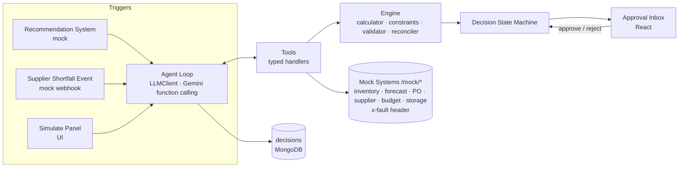
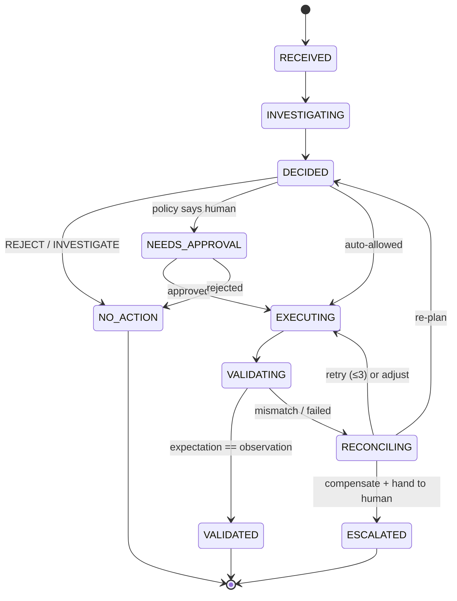

# AI Purchasing Agent — Implementation Plan

> **Guiding statement (from the assignment):**
> *"The goal is not to build a chatbot that answers purchasing questions. The goal is to demonstrate a system capable of making, executing, and validating purchasing decisions."*

---

## 0. Status: implemented (as-built notes)

All steps in §16 are implemented. 42 unit tests pass, and all 14 evaluation cases pass both live and in replay. Where the build deliberately differs from the plan below, the code and `docs/architecture.md` / `docs/approach.md` are authoritative:

- **State machine:** added `RECONCILING → NEEDS_APPROVAL` (an adjusted plan beyond auto limits), `INVESTIGATING → ESCALATED` (no accepted decision within 15 turns) and `DECIDED → ESCALATED` (an ESCALATE decision).
- **Data model:** added `skus` (category selects the budget, zone selects the storage), `storage.reservedInboundUnits` (space booked by other deliveries), `supplierTerms.backfillLeadDays`, and `purchaseOrders.pendingQty` / `confirmedQty`.
- **Need calculation (§8.1):** incoming POs count if they land **within the horizon**. Filtering them by the on-hand stockout date undercounts a PO arriving just after the stockout. The stockout day is simulated separately (continuous depletion with arrivals) and used only for risk.
- **Seed numbers (§11):** Scenario 1 keeps trueNeed 334, feasible 250 and storage binding, with PO-1041 arriving on day 2, DairyCo MOQ 200 (300 in case C) and 240 chilled units booked by other deliveries. Scenario 2 uses 420 on hand and PO-2001 due on day 6, giving a stockout on day 11.17 when only 250 arrive.
- **Tools (§7):** added `assess_shortfall` (the Scenario 2 engine). `compute_need` takes `{sku,node,supplierId,overrideIncoming?}` and fetches its own inputs. Write tools are not offered to the model; execution runs the engine's plan.
- **Decision guard:** `submit_decision` is rejected unless it matches the engine (decision, quantity, strategy, actions) and every required tool has succeeded.
- **Policy (§10):** buying **less** than recommended is automatic, and only increases above +20% need approval. An ADJUST after a failure re-executes automatically if it grows the order by at most 20%.
- **Idempotency key:** `${decisionId}:${actionIndex}:${type}:${attempt}`. A RETRY keeps the key; an ADJUST increments the attempt.
- **LLM:** Gemini via `@google/genai` behind `LLMClient`, recorded with `gemini-3.5-flash-lite`, because the free tier of `gemini-3.8-flash` is 20 requests per day. The model runs in 2 turns: all evidence and engine tools in parallel, then submit.
- **Eval:** 14 cases (the plan had 10): added an approval case and three Scenario 1 failure cases (timeout retry, read-back retry, quantity-mismatch compensation). Modes are replay, record and live; fixtures carry a model manifest.
- **Clock:** a simulated clock (`SIM_NOW`) drives business time; audit timestamps use wall time.

---

## 1. Problem in one paragraph

A quick-commerce company has human buyers who decide **what to buy, when, and how much** across many SKUs, suppliers and fulfillment nodes. They cross-check inventory, forecasts, open POs, supplier terms, budget and storage before acting. We build an agent that does that checking, makes a decision, **executes it, verifies the result, and recovers when the result is not what it expected** — pulling in a human only when the decision needs judgement.

## 2. What the brief asks for

| Line in the doc | What it means for the build |
|---|---|
| "Recommendation should not be assumed to be correct" | Agent computes its **own** quantity and compares; never rubber-stamps |
| "Multiple factors or constraints affect the final decision" | Need cases where constraints **conflict** (MOQ vs storage vs budget) |
| "What happens when the initial action does not work?" | Failure path must be **demonstrable**, not described |
| "When human approval may be appropriate" | Explicit **approval policy**; agent has bounded power |
| "We are particularly interested in the feedback loop" | Execute → validate → reconcile is the **core**, not a feature |
| "Depth over breadth; ≥1 scenario end-to-end" | Scenario 1 fully, then Scenario 2; 3 and 4 as roadmap |

## 3. Scope decision

**Build:** Scenario 1 (Recommendation Review) and Scenario 2 (Supplier Shortfall), both end-to-end with failure injection.

**Why these two:**
- S1 forces the full data model and the full decide → act → validate path.
- S2 is a *mid-flight failure of an action already taken*. It forces multi-step execution, compensation, supplier comparison, and re-planning — it **is** the feedback loop.
- S3 (demand change) ≈ S1 + an evidence-gathering step. S4 (constraint) is a mode that already occurs inside S1 and S2. Both are covered as roadmap items.

## 4. Core design principles

1. **LLM plans, code decides.** The LLM chooses which tools to call, interprets results, picks the branch, and writes the explanation. Every number (need, coverage, rounding), every constraint check, every state transition and every validation is deterministic TypeScript.
2. **Never trust a write.** After every action, read the record back and compare against the expected outcome.
3. **Bounded, idempotent retries.** Max 3; every write carries an `idempotencyKey`.
4. **Half-done is worse than undone.** On partial failure, compensate to a clean state, then escalate.
5. **Humans gate risk, not volume.** Policy table decides what auto-executes.
6. **Everything is traced.** Each decision is one document holding every tool call, expectation, observation and transition. The trace is the audit log, the UI, and the eval evidence.

## 5. Architecture

### Components



### Decision state machine



Every transition writes `{ from, to, at, reason, expected?, observed? }` into the decision document.

## 6. Data model (MongoDB, Mongoose)

| Collection | Key fields |
|---|---|
| `inventory` | sku, node, onHand, reserved, updatedAt |
| `forecasts` | sku, node, dailyMean, dailyStdDev, horizonDays, generatedAt |
| `purchaseOrders` | poId, sku, node, supplierId, qty, unitCost, totalCost, status (`CREATED·CONFIRMED·PARTIAL·SHIPPED·RECEIVED·CANCELLED`), expectedDate, idempotencyKey (unique), history[] |
| `suppliers` | supplierId, name, reliability { onTimeRate, fillRate, avgLeadDelta } |
| `supplierTerms` | supplierId, sku, leadTimeDays, moq, packSize, unitCost |
| `budgets` | node, category, period, total, reserved, spent |
| `storage` | node, zone (`chilled·ambient`), capacityUnits, usedUnits |
| `decisions` | decisionId, trigger, state, toolCalls[], computed{}, constraintsHit[], decision{}, actions[], validations[], transitions[], explanation, needsApproval |
| `poEvents` | poId, type (`SHORTFALL·CONFIRM·DELAY`), payload, receivedAt |

## 7. Tools exposed to the LLM

| Tool | Input → Output |
|---|---|
| `get_inventory` | sku, node → onHand, available, storage free |
| `get_demand_forecast` | sku, node, horizon → dailyMean, stdDev, freshness |
| `get_open_purchase_orders` | sku, node → [{poId, qty, expectedDate, status}] |
| `get_supplier_terms` | supplierId, sku → leadTime, moq, packSize, unitCost |
| `list_alternate_suppliers` | sku → ranked [{supplierId, leadTime, moq, unitCost, reliability, score}] |
| `get_budget` | node, category → remaining |
| `get_storage_capacity` | node, zone → free, projectedFree(date) |
| `get_purchase_order` | poId → full PO |
| `compute_need` | all of the above → coverageNeeded, projectedPosition, trueNeed, daysToStockout |
| `check_constraints` | qty, supplier, sku, node → feasibleQty, bindingConstraint, violations[] |
| `create_purchase_order` | sku, node, supplierId, qty, idempotencyKey → poId |
| `amend_purchase_order` | poId, newQty, reason → PO |
| `validate_purchase_order` | poId, expected{} → {ok, diffs[]} |
| `submit_decision` | Zod schema (final answer) → ends loop |

`submit_decision` schema:

```ts
{
  decision: "ACCEPT" | "MODIFY" | "REJECT" | "INVESTIGATE" | "ESCALATE",
  quantity?: number,
  supplierId?: string,
  actions: Array<{ type: "CREATE_PO" | "AMEND_PO" | "NONE", ... }>,
  reasoning: string[],          // bullet facts, each tied to a tool result
  constraintsHit: string[],
  confidence: "HIGH" | "MEDIUM" | "LOW",
  needsApproval: boolean,
  missingInformation?: string[] // for INVESTIGATE
}
```

The loop ends only when `submit_decision` is called. Hard cap 15 iterations.

## 8. Decision engine (deterministic)

### 8.1 Need calculation

```
reviewPeriod      = 7 days (config)
effectiveLeadTime = supplier.leadTimeDays + supplier.reliability.avgLeadDelta
horizon           = effectiveLeadTime + reviewPeriod
demandOverHorizon = dailyMean × horizon
safetyStock       = z × dailyStdDev × √(effectiveLeadTime)      // z = 1.65 (~95% service)
coverageNeeded    = demandOverHorizon + safetyStock
incomingInWindow  = Σ open PO qty with expectedDate ≤ projected stockout date
projectedPosition = onHand + incomingInWindow
trueNeed          = max(0, coverageNeeded − projectedPosition)
daysToStockout    = onHand / dailyMean  (then + incoming as it lands)
```

### 8.2 Constraint resolution (in order)

1. `qty = roundUpToPack(max(trueNeed, moq))`
2. Budget cap: `maxByBudget = roundDownToPack(remaining / unitCost)`
3. Storage cap: `maxByStorage = roundDownToPack(projectedFree(deliveryDate))`
4. `feasibleQty = min(qty, maxByBudget, maxByStorage)`
5. If `feasibleQty < moq` → **no feasible quantity** → ESCALATE
6. Record `bindingConstraint` (which cap won)

### 8.3 Data trust checks (→ INVESTIGATE)

- forecast older than 48h
- negative or null inventory
- open PO with missing expectedDate
- supplier terms missing for the SKU

### 8.4 Scenario 1 decision tree

| Finding | Decision |
|---|---|
| Data fails trust checks | INVESTIGATE (list what's missing) |
| trueNeed = 0 | REJECT |
| feasibleQty within ±10% of recommendation | ACCEPT (recommended qty) |
| feasibleQty differs | MODIFY → feasibleQty |
| no feasible qty (MOQ > caps) | ESCALATE with options |

### 8.5 Scenario 2 decision tree

Trigger: `poEvents` SHORTFALL on PO-X (promised Q, confirmed q).

| Finding | Decision |
|---|---|
| onHand + q covers horizon | Accept partial: amend PO-X → q. No new PO. |
| Gap matters; same supplier can backfill before stockout | Split: amend PO-X → q, create PO-Y same supplier for Q−q |
| Gap matters; alternate supplier scores best and cost delta ≤ 10% | Re-source: amend PO-X → q, create PO-Y with alt supplier |
| Alt supplier cost delta > 10% or reliability < threshold | ESCALATE with priced options |
| Nobody delivers before stockout | ESCALATE as stockout risk |

Supplier score: `score = w_cost·(1 − costDelta) + w_speed·leadTimeFit + w_rel·onTimeRate`, weights per SKU category.

## 9. Feedback loop

### 9.1 Three validation levels

| Level | When | Checks |
|---|---|---|
| L1 Immediate | seconds after write | PO exists; qty, supplier, cost, status match; budget reserved exactly once |
| L2 Short-term | supplier confirmation event | confirmed qty == ordered qty; date within tolerance. Mismatch → triggers Scenario 2 |
| L3 Outcome | after lead time (simulated) | stock stayed > 0 and < capacity; writes back to `suppliers.reliability` |

L1 and L2 are built. L3 is a `scripts/simulate.ts` fast-forward plus reliability write-back (stretch).

### 9.2 Reconciliation moves (exactly four)

| Move | Condition | Example |
|---|---|---|
| **Retry** | transient (timeout, 503, not-found-yet) | re-read PO, ≤3 attempts, same idempotencyKey |
| **Adjust** | succeeded but different, still acceptable | PO bumped to MOQ; re-run constraints; accept if feasible |
| **Compensate** | partial multi-step failure | revert PO-X amendment, then escalate |
| **Escalate** | retries exhausted, no safe fix, or needs judgement | hand clean state + options to buyer |

### 9.3 Multi-action execution (S2)

Order: amend first (frees budget), then create. If create fails → adjust (re-fetch terms, re-check, retry once) → if still failing → compensate (revert amend) → escalate. Amendments are "soft" (not sent to supplier) until the whole decision validates, so revert is safe.

## 10. Human approval policy

| Action | Auto? |
|---|---|
| REJECT / INVESTIGATE | yes |
| ACCEPT / MODIFY within ±20% of rec, within budget & storage, PO ≤ ₹1,00,000 | yes |
| MODIFY beyond ±20%, or PO > ₹1,00,000 | approval |
| Switch supplier (cost delta > 10%) | approval |
| Cancel an existing PO | approval |
| Any action after a reconciliation failure | approval |

Policy lives in `engine/policy.ts` as data, not scattered `if`s.

## 11. Scenario walkthroughs (demo narrative)

### Scenario 1 — "Buy 800 BUTTER-500 at BLR-01"

Seed: onHand 150 · forecast 60/day σ=10 · open PO-1041 400 units in 3 days · DairyCo 7d / MOQ 300 / pack 50 / ₹240 · budget ₹1,00,000 · chilled free 500.

Computed: horizon 14 → demand 840 + safety ~44 → coverage ~884 · position 550 · **trueNeed ~334** → pack-rounded 350 · budget cap 416→400 · storage cap (500 − 400 + 180) = 280→250 · **binding: storage**.

Decision: **MODIFY 800 → 250**. Create PO-1042, read back, validate, explain. Note a ~100-unit top-up after PO-1041 lands.

Variants for eval: A accept · B modify (above) · C escalate (MOQ 300 vs storage 250) · D investigate (stale forecast).

### Scenario 2 — "PO-2001: 500 ordered, DairyCo confirms 250"

Seed: onHand 240 · 60/day · PO-2001 due day 7 · DairyCo backfill day 12 · FreshFarms 3d / MOQ 200 / ₹252 / 95% · ButterHouse 2d / MOQ 500 / ₹300 / 70%.

Computed: 240/60 = 4 days; 250 lands day 7 → **stockout days 5–7**. Shortfall matters. DairyCo too late. FreshFarms scores best, +5% cost → auto-allowed.

Decision: amend PO-2001 → 250; create PO-2002 FreshFarms 250 due day 4. Validate both. Explain.

Failure injection (`x-fault: reject_moq` on create): FreshFarms MOQ now 300 → adjust to 300, re-check budget/storage, retry → validate whole picture. Second failure (`x-fault: budget_exceeded`) → compensate (PO-2001 back to 500) → ESCALATE with options.

Variants for eval: A accept partial · B split same supplier · C re-source · D escalate (alt +40%) · E adjust-after-MOQ-reject · F compensate-and-escalate.

## 12. Tech stack

| Layer | Choice | Reason |
|---|---|---|
| Backend | Node 20 + Express + TypeScript | most fluent; TS enforces the decision contract |
| LLM | Google Gemini via `@google/genai` (free tier), function calling, Flash / Flash-Lite model, behind a provider-agnostic `LLMClient` interface; hand-rolled loop (~60 lines) | free, no card; must own and explain the loop; swapping provider = one new adapter file |
| Structured output | Zod → JSON schema → `submit_decision` tool | no prose parsing |
| DB | MongoDB + Mongoose; `docker-compose` for reviewer | decision trace is a document; unique index = idempotency |
| Frontend | React + Vite + TS + TanStack Query | inbox, trace, approve, simulate panel |
| Shared | `shared/` package for Zod schemas | one contract for agent, API, UI |
| Mocks | `/mock/*` routes in same process, called over HTTP, `x-fault` header | honest boundary, swappable, fault-injectable |
| Eval | Vitest + `eval/scenarios/*.json`, recorded LLM fixtures, `LIVE=1` flag | deterministic CI, one live check |

## 13. Repository structure

```
.
├── README.md                  # 3-command run
├── .env.example               # LLM_PROVIDER, GEMINI_API_KEY, MODEL, LLM_MIN_INTERVAL_MS, MONGO_URI, PORT
├── docker-compose.yml         # mongo
├── docs/
│   ├── architecture.md        # mermaid diagrams (above)
│   ├── approach.md            # principles, trade-offs, roadmap
│   ├── evaluation.md          # cases, assertions, results table
│   └── implementation-plan.md # this file
├── shared/                    # zod schemas, types
├── server/src/
│   ├── mock/                  # inventory, forecast, po, supplier, budget, storage (+ fault)
│   ├── tools/                 # one file per tool {schema, handler}
│   ├── engine/                # calculator, constraints, policy, stateMachine, validator, reconciler
│   ├── agent/                 # loop, llm (LLMClient + Gemini adapter), prompts, decisionSchema
│   ├── events/                # supplierShortfall handler
│   ├── models/                # mongoose
│   ├── routes/                # /decisions, /approve, /simulate, /eval
│   └── seed/                  # seed.ts + data/*.json
├── client/src/                # Inbox, DecisionDetail, SimulatePanel, EvalTab
├── eval/scenarios/*.json
└── scripts/simulate.ts        # L3 outcome fast-forward (stretch)
```

## 14. Evaluation approach

Each case file:

```json
{
  "name": "s1-modify-open-po",
  "seed": "seeds/s1-b.json",
  "trigger": { "type": "RECOMMENDATION", "sku": "BUTTER-500", "node": "BLR-01", "qty": 800 },
  "fault": null,
  "expect": {
    "decision": "MODIFY",
    "quantity": 250,
    "finalState": "VALIDATED",
    "toolsCalledIncludes": ["get_inventory","get_demand_forecast","get_open_purchase_orders","get_supplier_terms","get_budget","get_storage_capacity","compute_need","check_constraints"],
    "constraintsHit": ["STORAGE"],
    "validated": true
  }
}
```

Assertions map 1:1 to the doc's questions:

| Doc question | Assertion |
|---|---|
| Was the decision correct? | `decision`, `quantity` |
| Did it obtain the necessary information? | `toolsCalledIncludes` before `submit_decision` |
| Did it respect constraints? | `constraintsHit`, qty ≤ caps |
| Did it take the appropriate action? | `actions[]` types |
| Did it validate? | `validations[].ok`, `finalState` |
| What if the action fails? | cases with `fault`, expect `RECONCILING` transitions + final state |

Ten cases (S1: A–D, S2: A–F). `GET /eval/run` renders a pass/fail table in the UI's Evaluation tab.

## 15. Build order — commit at each checkpoint

| # | Block | Hrs | Done when |
|---|---|---|---|
| 1 | Mongoose models, seed loader, `/mock/*` with `x-fault` | 1.5 | `curl /mock/inventory?sku=…` works; fault header flips behaviour |
| 2 | `engine/`: calculator, constraints, policy, stateMachine, validator, reconciler + unit tests | 2.0 | S1 variants A–D pass as pure-function tests, no LLM |
| 3 | Tools + Zod `submit_decision` + agent loop | 1.5 | `POST /simulate/recommendation` produces a VALIDATED decision doc |
| 4 | Scenario 1 e2e, then Scenario 2 (events, amend, multi-action, compensate) | 1.5 | S2 cases A–F pass with fault injection |
| 5 | React: Inbox, DecisionDetail trace, Approve, SimulatePanel, EvalTab | 1.0 | demo runs from the UI only |
| 6 | README, `.env.example`, docs, Mermaid, eval results table | 0.5 | fresh clone → running in 3 commands |

Rule: block 4's Scenario 1 must be fully validated before Scenario 2 begins. Stretch (if time): supplier reliability write-back from L2/L3.

## 16. Implementation — end-to-end changes

This section turns every item above into the concrete files, functions and commands to write, in the order they should land. Each step ends with what must be true before moving on. Commit at every step boundary.

### Step 0 — Scaffold (20 min)

Create the monorepo with npm workspaces: `shared/`, `server/`, `client/`, `eval/`.

- `package.json` (root): `workspaces: ["shared","server","client"]`, scripts `dev`, `seed`, `test`, `eval`.
- `docker-compose.yml`: single `mongo:7` service, port 27017, named volume.
- `.env.example`: `LLM_PROVIDER=gemini`, `GEMINI_API_KEY=` (empty), `MODEL=` (empty; set to a current Flash or Flash-Lite model name from Google AI Studio — names change), `LLM_MIN_INTERVAL_MS=4000` (minimum gap between model calls; raise it if you see 429s), `MONGO_URI=mongodb://localhost:27017/purchasing`, `PORT=4000`.
- `.gitignore`: `.env`, `node_modules`, `dist`, `eval/fixtures/live/`.
- `server/`: Express + TS (`tsx` for dev), `client/`: Vite React TS, `shared/`: TS lib with Zod.

Done when: `docker compose up -d && npm i && npm run dev` starts server on 4000 and client on 5173.

### Step 1 — Shared contracts (`shared/`) (20 min)

One place for every type the agent, API and UI touch. Implements §7 schema and §5 state machine as types.

- `shared/src/decision.ts`: `DecisionSchema` (Zod) exactly as §7 `submit_decision`; `DecisionState` enum (§5); `Transition`, `ToolCallRecord`, `ValidationRecord`, `ActionRecord` types.
- `shared/src/domain.ts`: `Inventory`, `Forecast`, `PurchaseOrder`, `Supplier`, `SupplierTerms`, `Budget`, `Storage`, `PoEvent` types matching §6.
- `shared/src/trigger.ts`: `Trigger = RecommendationTrigger | ShortfallTrigger`.

Done when: `zodToJsonSchema(DecisionSchema)` produces valid JSON schema (unit test).

### Step 2 — Models and seed (`server/src/models`, `server/src/seed`) (40 min)

Implements §6.

- One Mongoose model per collection. `PurchaseOrder` gets `idempotencyKey: { unique: true, sparse: true }` and a `history: [{ at, from, to, reason }]` subdoc. `Decision` stores the full trace document.
- `seed/data/base.json`: the §11 seed (BUTTER-500, BLR-01, DairyCo, FreshFarms, ButterHouse).
- `seed/data/variants/*.json`: deltas for S1 A–D and S2 A–F (e.g. `s1-d.json` sets `forecast.generatedAt` to 3 days ago).
- `seed/seed.ts`: `seed(variantName?)` drops collections, loads base, applies variant delta. Exposed as `npm run seed -- s1-b` and as `POST /simulate/seed { variant }` so the UI and eval can reset state.

Done when: `npm run seed -- s1-b` then `mongosh` shows PO-1041 with 400 units.

### Step 3 — Mock external systems (`server/src/mock`) (40 min)

Implements the "external" boundary. All routes under `/mock/*`, read/write Mongo directly, and honour `x-fault`.

- `mock/fault.ts`: `readFault(req): Fault | null` with union `"mismatch_qty" | "not_found" | "reject_moq" | "timeout" | "budget_exceeded" | "partial_confirm"`. A fault applies **once** per `x-fault-key` (store consumed keys in memory) so retries can succeed.
- `mock/inventory.ts`: `GET /mock/inventory?sku&node`.
- `mock/forecast.ts`: `GET /mock/forecast?sku&node&horizon` → mean, stdDev, generatedAt.
- `mock/po.ts`: `GET /mock/po?sku&node&status=open`, `GET /mock/po/:id`, `POST /mock/po` (honours idempotencyKey: duplicate → return existing, 200), `PATCH /mock/po/:id` (amend qty, pushes history). Faults: `reject_moq` → 422 with `{moq}`; `mismatch_qty` → saves qty bumped to MOQ; `not_found` → GET returns 404 once; `timeout` → delay 6s then 504.
- `mock/supplier.ts`: `GET /mock/suppliers/terms?supplierId&sku`, `GET /mock/suppliers/alternates?sku`, `GET /mock/suppliers/:id/backfill?sku&qty` → earliest date.
- `mock/budget.ts`: `GET /mock/budget?node&category`, `POST /mock/budget/reserve` (fault `budget_exceeded` → 409).
- `mock/storage.ts`: `GET /mock/storage?node&zone&date` → `free`, `projectedFree`.
- `mock/events.ts`: `POST /mock/events/shortfall { poId, confirmedQty }` writes `poEvents` and emits in-process event (Step 7).

Done when: every route answers with seed data; `curl -H "x-fault: reject_moq" -X POST /mock/po` returns 422 once, then 201 on the same `x-fault-key`.

### Step 4 — Deterministic engine (`server/src/engine`) (2 h)

Pure functions, no I/O, no LLM. Implements §8, §9, §10. Unit-test every file.

- `engine/calculator.ts`
  `computeNeed(input: NeedInput): NeedResult` — implements §8.1 exactly; returns every intermediate (`horizon`, `demandOverHorizon`, `safetyStock`, `coverageNeeded`, `incomingInWindow`, `projectedPosition`, `trueNeed`, `daysToStockout`, `stockoutDate`). Intermediates go into the trace.
- `engine/constraints.ts`
  `resolveConstraints(input): ConstraintResult` — §8.2; returns `feasibleQty`, `bindingConstraint: "MOQ"|"BUDGET"|"STORAGE"|"NONE"`, `violations[]`, `noFeasibleQty: boolean`. Helpers `roundUpToPack`, `roundDownToPack`.
- `engine/trust.ts`
  `checkDataTrust(snapshot): TrustIssue[]` — §8.3.
- `engine/policy.ts`
  `POLICY` table as data (§10); `requiresApproval(decision, context): { required, reason }`.
- `engine/supplierScore.ts`
  `rankSuppliers(candidates, need, weightsByCategory)` — §8.5 formula; returns sorted with `score` and `costDelta`.
- `engine/stateMachine.ts`
  `ALLOWED: Record<DecisionState, DecisionState[]>`; `transition(decision, to, meta)` throws on illegal move, appends to `transitions[]`.
- `engine/validator.ts`
  `validatePo(expected, observed): ValidationResult` — field-by-field diff (qty, supplierId, totalCost, status, expectedDate); `validateDecisionOutcome(decision, world)` — whole-picture check (total incoming ≥ need, total reserved ≤ budget).
- `engine/reconciler.ts`
  `classify(failure): "RETRY"|"ADJUST"|"COMPENSATE"|"ESCALATE"` by error type and attempt count (§9.2); `plan(move, context)` returns the next concrete action (re-read, re-fetch terms + recompute, revert action N, or escalation payload).

Done when: `vitest run engine` is green for S1 A–D and S2 A–F computed purely from seed snapshots (no HTTP, no LLM).

### Step 5 — Tools (`server/src/tools`) (45 min)

Implements §7. Each tool is `{ name, description, inputSchema (Zod), handler(input, ctx) }`. Handlers call `/mock/*` over HTTP via a tiny `http.ts` client that forwards `x-fault` and `x-fault-key` from `ctx` (so eval can inject faults per decision), and log `{ name, input, output, ms }` into `ctx.decision.toolCalls`.

- `tools/registry.ts`: exports `TOOLS[]` and `toToolDeclarations()` — Zod → JSON schema → provider-neutral `{ name, description, parameters }`. The Gemini adapter (Step 6) converts these to Gemini function declarations.
- Read tools: `get_inventory`, `get_demand_forecast`, `get_open_purchase_orders`, `get_supplier_terms`, `list_alternate_suppliers` (calls engine `rankSuppliers`), `get_budget`, `get_storage_capacity`, `get_purchase_order`.
- Compute tools: `compute_need` (wraps `calculator`), `check_constraints` (wraps `constraints` + `trust`).
- Write tools: `create_purchase_order`, `amend_purchase_order` — both record an `ActionRecord` and both are **blocked** unless `ctx.decision.state === "EXECUTING"` (the LLM cannot write during INVESTIGATING).
- `validate_purchase_order` (wraps `validator`).
- `submit_decision`: validates against `DecisionSchema`, stores it on the decision, returns `{ accepted: true }` — the loop treats this as terminal.

Done when: calling each handler directly against seed returns typed output; write tools throw outside EXECUTING.

### Step 6 — Agent loop and prompts (`server/src/agent`) (45 min)

Implements §4 principle 1 and the §7 loop.

- `agent/llm.ts`: the only file that imports `@google/genai`. Exports `LLMClient { generate(req: { system, messages, tools }): Promise<{ text?, toolCalls: { id, name, args }[], raw }> }` and `GeminiClient implements LLMClient`. The adapter (a) maps neutral messages/tools to Gemini contents and function declarations and back, generating call ids if the API returns none; (b) sanitises tool schemas — strip `$schema` and `additionalProperties`, inline `$ref`, keep only keywords Gemini accepts; (c) appends the model's returned content to history **unchanged** instead of rebuilding it, since the API can require opaque fields from earlier turns; (d) requires a tool call each turn via the SDK's function-calling mode where supported, otherwise re-prompts once; (e) handles 429/503 with exponential backoff (max 5 retries, honouring any retry delay the API reports) and enforces `LLM_MIN_INTERVAL_MS` between calls. Also add `npm run llm:ping`: one minimal tool-calling request through `LLMClient` that prints the returned tool call — run it before building the loop to prove the key, model name and function calling work. Verify the package name and current API with `npm view @google/genai` and the SDK's own docs; do not rely on memory.
- `agent/prompts.ts`: system prompt stating role, the 5 decisions, that quantities must come from `compute_need`/`check_constraints`, that `submit_decision` must be called exactly once, and the required tool order for each trigger type (gather → compute → constraints → submit).
- `agent/loop.ts`: `runAgent(decisionId, trigger, ctx)`:
  1. `transition(RECEIVED → INVESTIGATING)`
  2. loop ≤ 15: call `llm.generate({ system, tools, messages })` through `LLMClient`; for each returned tool call execute via registry; append the tool result as a function response; stop on `submit_decision`.
  3. `transition(INVESTIGATING → DECIDED)`; attach `decision`.
  4. `requiresApproval` → `NEEDS_APPROVAL` and return; `NO_ACTION` for REJECT/INVESTIGATE; else `execute(decisionId)`.
- `agent/execute.ts`: `execute(decisionId)` — `transition(→ EXECUTING)`; run `decision.actions[]` in order through the write tools; `transition(→ VALIDATING)`; for each action call `validate_purchase_order` with expectation; then `validateDecisionOutcome`; all ok → `VALIDATED`, else hand to `reconcile`.
- `agent/reconcile.ts`: `reconcile(decisionId, failure)` — `transition(→ RECONCILING)`; `move = reconciler.classify(...)`; RETRY → re-run validate with backoff (attempt++), ADJUST → re-fetch terms, recompute via engine, rewrite the failed action, back to EXECUTING; COMPENSATE → revert completed actions in reverse order (amend back to original qty), then ESCALATE; ESCALATE → build `escalation { summary, options[] }`, `transition(→ ESCALATED)`. After any reconciliation, `requiresApproval` forces `NEEDS_APPROVAL` before re-execution (§10 last row).
- `agent/explain.ts`: builds the buyer-facing note from `decision.reasoning`, `computed`, `constraintsHit`, `actions`, `validations` — this is deterministic text assembly plus the LLM's `reasoning[]`, not a second LLM call.

Done when: `npm run llm:ping` prints a tool call from Gemini; and `POST /simulate/recommendation` on seed `s1-b` produces a decision doc in `VALIDATED` with `MODIFY 250`, PO-1042 present, `validations[0].ok === true`; a unit test shows the sanitised tool declarations contain no `$schema`, `additionalProperties` or `$ref`.

### Step 7 — Scenario 2 wiring (`server/src/events`) (40 min)

- `events/bus.ts`: Node `EventEmitter`.
- `events/shortfall.ts`: on `po.shortfall { poId, confirmedQty }` → create a decision with `ShortfallTrigger` → `runAgent`. The prompt branch for this trigger requires `get_purchase_order`, `get_inventory`, `get_demand_forecast`, `compute_need` (with incoming = confirmedQty), `get_supplier_terms` (backfill), `list_alternate_suppliers`, `get_budget`, `get_storage_capacity` before `submit_decision`.
- `execute.ts` already handles ordered multi-action (`AMEND_PO` then `CREATE_PO`); add `softAmend: true` flag on amendments — the mock PO route stores `pendingQty` until the decision reaches `VALIDATED`, at which point `POST /mock/po/:id/commit` finalises. This makes COMPENSATE a safe revert (§9.3).
- Reconciler `ADJUST` path for `reject_moq`: read `moq` from the 422 body, `roundUpToPack(max(qty, moq))`, re-run `check_constraints`, retry once with the same idempotency key family (`${decisionId}:create:${attempt}`).

Done when: `POST /mock/events/shortfall { poId: "PO-2001", confirmedQty: 250 }` on seed `s2-c` yields VALIDATED with PO-2001 = 250 and PO-2002 (FreshFarms, 250); with `x-fault: reject_moq` yields PO-2002 = 300 after one ADJUST; with `reject_moq` + `budget_exceeded` yields ESCALATED and PO-2001 back at 500.

### Step 8 — API routes (`server/src/routes`) (30 min)

- `GET /decisions` (list, filter by state), `GET /decisions/:id` (full trace).
- `POST /decisions/:id/approve` → `execute`; `POST /decisions/:id/reject` → `NO_ACTION`.
- `POST /simulate/seed { variant }`, `POST /simulate/recommendation { sku, node, qty, fault? }`, `POST /simulate/shortfall { poId, confirmedQty, fault? }` — `fault` is forwarded as `x-fault` into the decision context.
- `GET /eval/run` → runs all `eval/scenarios/*.json` in-process (Step 10) and returns the table.
- `GET /health`.

Done when: the entire S1/S2 demo can be driven with curl only.

### Step 9 — Client (`client/src`) (1 h)

- `api.ts` + TanStack Query hooks; poll `GET /decisions/:id` every 1s while state is not terminal.
- `pages/Inbox.tsx`: table of decisions — trigger, SKU/node, decision, state badge (colour per state), needsApproval flag.
- `pages/DecisionDetail.tsx`: three panels — **Trace** (toolCalls in order with input/output collapsible), **Numbers** (`computed`, `constraintsHit`, `bindingConstraint`), **Actions & Validation** (each action with expected vs observed diff, transitions timeline, escalation options if any). Approve/Reject buttons when `NEEDS_APPROVAL`.
- `components/SimulatePanel.tsx`: seed variant dropdown + buttons: "Recommend 800 (S1)", "Shortfall PO-2001 → 250 (S2)", fault selector (`none | mismatch_qty | not_found | reject_moq | timeout | budget_exceeded`), "Run".
- `pages/EvalTab.tsx`: calls `GET /eval/run`, renders pass/fail per case with the failing assertion.

Done when: the full demo is performed without a terminal.

### Step 10 — Evaluation harness (`eval/`) (40 min)

- `eval/scenarios/*.json` — the 10 cases from §14.
- `eval/runner.ts`: for each case → `seed(variant)` → fire trigger with `fault` → wait for terminal state → assert `expect.*` against the decision doc. Returns `{ name, pass, failures[] }`.
- `eval/llm-cache.ts`: wraps `LLMClient.generate`; key = sha256(provider + model + system + messages + tools); `LIVE=1` bypasses and refreshes `eval/fixtures/*.json`; default reads fixtures and fails loudly on a miss. Commit fixtures. Free-tier quota: the runner executes cases sequentially and supports `--case <name>`; because every response is cached per request, a run that stops on a quota error resumes where it left off.
- `eval/eval.test.ts`: Vitest `test.each(cases)`; runs offline in CI.

Done when: `npm run eval` prints 10/10 offline; `LIVE=1 npm run eval` passes against the API.

### Step 11 — Docs and submission (30 min)

- `README.md`: what it is, 3-command run, demo script (which buttons to press in which order), screenshots/GIF, link to docs.
- `docs/architecture.md`: paste §5 diagrams; one paragraph per component.
- `docs/approach.md`: §4 principles, §17 trade-offs, §18 roadmap table.
- `docs/evaluation.md`: §14 plus the results table from `GET /eval/run`.
- Verify `.env` is untracked, run `git log --oneline` and confirm the history reads as a build story.

Done when: §19 submission checklist is fully ticked on a fresh clone.

### Cross-cutting rules while implementing

- Every write tool call includes `idempotencyKey = ${decisionId}:${actionType}:${attempt}`.
- No tool handler may call the LLM; no engine function may do I/O.
- Every tool call, transition, action and validation is appended to the decision document before the next step runs — if the process dies, the trace shows exactly where.
- Faults are consumed once per key so that retries can legitimately succeed; this is what makes RETRY testable.
- Prompt changes require re-running `LIVE=1 npm run eval` and committing refreshed fixtures.

## 17. Trade-offs (what I chose · what it costs · when I'd change it)

1. **LLM plans, code decides** — vs end-to-end LLM reasoning. Costs flexibility on unforeseen calculations. Right because money moves and answers must be reproducible. Would loosen if every decision had a human reviewer anyway.
2. **Hand-rolled loop** — vs LangChain/agent framework. Costs free retries/tracing/parallel calls. Right because I must explain and modify it live. Would adopt a framework for observability once the loop stabilises.
3. **Auto-execute within policy** — vs always ask. Costs margin-of-safety on auto cases. Right because full approval = zero time saved. Policy limits are the dial; start tight.
4. **Read-back validation** — vs trusting write responses. Costs an extra call per write. Right because "accepted" ≠ "ended in the expected state" (async, MOQ bumps, races).
5. **Compensate on partial failure** — vs forward-fix or leave. Costs: revert can confuse a supplier already notified. Right because amendments are soft until validated; if already sent, escalate instead of reverting.
6. **MongoDB** — vs Postgres. Costs cross-collection transactions and ledger-grade integrity. Right for speed and because the trace is a document. In prod, money-related writes would use a transaction or Postgres.
7. **Mocks in-process over HTTP** — vs separate services. Costs realism (no auth, partitions). Right for the scope of this assignment; HTTP boundary keeps swap-to-real a URL change.
8. **Depth on S1+S2** — vs all four. Costs demonstrating S3's evidence reasoning. Right per the brief; S3 ≈ S1 + one step, S4 is inside both.
9. **Recorded LLM fixtures in tests** — vs live model. Costs testing current-model behaviour. Right because pipeline bugs are the real risk and LLM output is nondeterministic; one live flag covers drift. Recorded fixtures also mean free-tier quota is spent once, not on every test run.
10. **Gemini free tier behind an `LLMClient` interface** — vs a paid frontier model. Costs free-tier rate limits (requests per minute and per day) and weaker multi-step tool-following than frontier models. Right because it is free with no card, and the deterministic engine, not the model, carries correctness. The interface makes a provider swap one adapter file (Anthropic, OpenAI-compatible). Would pay for a stronger model, with routing and fallback, once cost matters.

## 18. Roadmap / open points (plug-ins, no architecture change)

| Problem | What plugs in | Effort |
|---|---|---|
| Supplier reliability | `supplierPerformance` collection; validator writes back on L2/L3; calculator uses effective lead time + fill rate | 1–2h |
| Alternate suppliers | weighted score in `engine/`, weights per category | 1h |
| Safety stock | σ from forecast, z per service level (already in calculator) | 0.5h |
| Forecast anomalies (S3) | `demandAnomaly` trigger; `get_sales_history`; evidence step (duration, breadth); re-forecast rule | 2h |
| Replenishment sweep | cron trigger over all SKU-nodes → S1 path with no external rec | 1h |
| Promotional buying | `promotions` collection; forecast overlay; post-promo overstock check | 1.5h |
| Seasonal demand | monthly factor; forecast as function of delivery date | 0.5h |
| Open PO hygiene | late-PO trigger → S2 logic; duplicate detection | 1h |
| Budget reallocation (own) | `get_budget_by_category`; `propose_budget_transfer` gated to approval | 1h |

Next to build if time remains: **supplier reliability write-back** — it makes validation improve future decisions.

## 19. Submission checklist

- [x] Source complete, TS compiles, `npm test` green
- [x] README: setup + run in 3 commands, screenshots/GIF of demo
- [x] Architecture diagram (components + state machine)
- [x] `docs/approach.md` with principles, trade-offs, roadmap
- [x] `docs/evaluation.md` with cases and results table
- [x] Mock APIs + seed data in repo
- [x] Validation explained (3 levels, 4 moves)
- [x] Working demo via Simulate panel
- [x] `.env.example`, no secrets, `.gitignore` covers `.env`
- [x] Commit history: small, descriptive, all before deadline
